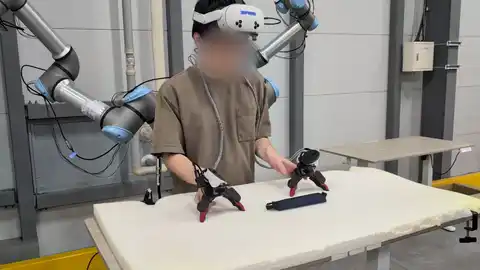
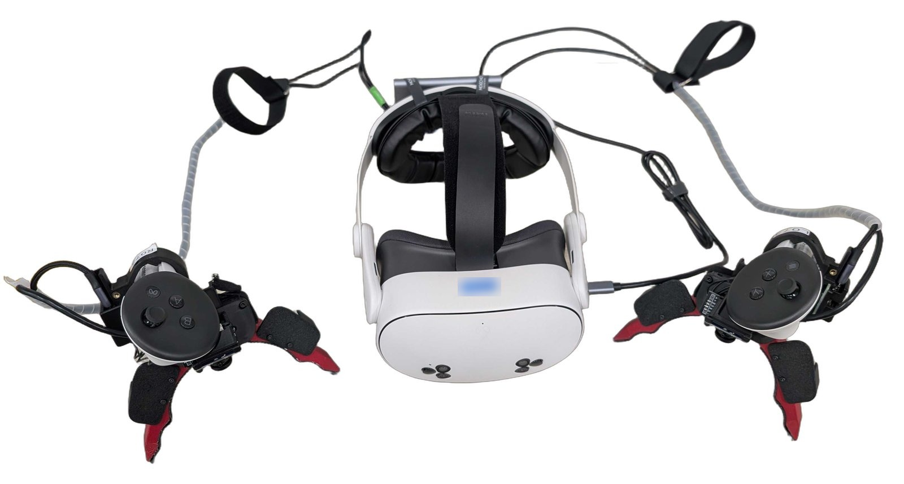

# YUBI Go

YUBI Go is a Rust app for Meta Quest 3 / 3S that records robot-learning demonstrations from two handheld grippers: the YUBI Gloves of [YUBI](https://github.com/Toyota/yubi-hw), the open-source hardware of Toyota Motor Corporation's Frontier Research Center. Everything plugs into the headset through one USB hub, and the headset records the episodes.

<table>
  <tr>
    <th>Collect with YUBI Go</th>
    <th>Deploy the trained policy on a robot</th>
  </tr>
  <tr>
    <td></td>
    <td></td>
  </tr>
</table>

For more examples of YUBI in use, see the [YUBI project page](https://yubi.airoa.io) and
[AIRoA-0](https://a-0.airoa.io).

The headset shows passthrough with the live cameras and gripper states overlaid. It also
serves two things on the local network:

- `:8080`: a web page for setup, live preview, the episode list and an episode viewer, plus MJPEG
  streams.
- `:9090`: a rosbridge server that publishes the recording state and the poses to any rosbridge
  client on your network. It is optional, and a standalone rig records without it.

Each episode is a `signals.mcap` (ROS 2 message encoding) plus a `meta.json`. A standalone rig
takes its tasks from the headset's own task list and stores the cameras as H.264. A production rig
takes them from AIRoA's backend and stores JPEG frames
([standalone and production](docs/manual.md#3-standalone-and-production)). The `video` key in
`config.json` (`"h264"` or `"jpeg"`) overrides that. The episode viewer exports episodes as a
LeRobot v2.1 dataset on the headset, and `yubi-export` does the same on your own computer
([`docs/lerobot-export.md`](docs/lerobot-export.md)). Uploads to an
S3-compatible bucket are optional.

## Hardware



YUBI Go is software only. To record, you need:

- Two YUBI Gloves, the handheld grippers of [`Toyota/yubi-hw`](https://github.com/Toyota/yubi-hw),
  each with its wrist camera, angle encoder and Quest controller.
- A Meta Quest 3 or 3S.
- A USB hub with a USB-C plug and four USB-A ports, for the two wrist cameras and the two
  encoders. An optional head camera fixed to the headset needs a fifth port.

The Quest's own head strap gets uncomfortable over a long session, so we recommend a
third-party strap. The [manual](docs/manual.md#1-hardware) says what each part does.

## Install

You need a computer with `adb` ([Android platform-tools](https://developer.android.com/tools/releases/platform-tools)),
and the headset in developer mode (set in the Meta Horizon phone app).

1. Download `yubi-go.apk` from the [latest release](https://github.com/airoa-org/yubi-go/releases/latest).
2. Connect the headset to the computer with a USB cable. Accept the prompt in the headset, and
   tick "Always allow from this computer".
3. Install the app, and allow it to use the cameras:

   ```bash
   adb install -r yubi-go.apk
   adb shell pm grant org.airoa.yubigo android.permission.CAMERA
   adb shell pm grant org.airoa.yubigo horizonos.permission.USB_CAMERA
   ```

4. Unplug the cable, plug in the hub, and open YUBI Go from the headset's library (under
   "Unknown sources").

The [manual](docs/manual.md) covers first setup, recording and troubleshooting.

The hub takes the headset's only USB-C port. So if you want adb while the hub is plugged in, for
logs or updates, switch adb to Wi-Fi before you unplug the cable. Repeat this after every headset
reboot:

```bash
IP=$(adb shell ip route | grep -o 'src [0-9.]*' | cut -d' ' -f2)
adb tcpip 5555 && sleep 5 && adb connect $IP:5555
```

Use adb over Wi-Fi only on a network you trust, because port 5555 stays open to that network until
the headset reboots.

To build the APK yourself, see [`docs/building.md`](docs/building.md).

## Safety

- Follow Meta's health and safety warnings for the headset.
- The app shows passthrough and draws no boundary, so keep the work area clear.
- Route the cables from the headset to the grippers away from your neck.
- Use a rated USB hub and charger, and stop if anything gets hot.
- YUBI Go is research software, provided as is.

## Privacy

Episodes hold camera video of people and rooms, and `meta.json` names the operator and the site.
Get consent from the people in view before you record. The app sends nothing to the internet
except to the bucket or backend you configure, but anyone on the same network can watch the cameras
and download episodes ([Security](#security)). Without uploads, episodes stay on the headset until you delete
them. With an upload target, sent episodes are deleted after `local_retention_hours` (24 when
unset). The [manual](docs/manual.md#16-privacy-and-data) lists everything an episode holds.

## Security

The `:8080` and `:9090` servers have no authentication, and by design any web page on the same
network can read the live camera streams. YUBI Go is research software, not built for commercial
deployment. Run the headset only on a network you trust. See [`SECURITY.md`](SECURITY.md).

## Contact

Report bugs and request features in [GitHub issues](https://github.com/airoa-org/yubi-go/issues).
For other questions about YUBI Go, write to [ext-oss@airoa.org](mailto:ext-oss@airoa.org).

## Licence

Apache-2.0 ([`LICENSE`](LICENSE)). Third-party material keeps its own licence; see
[`NOTICE`](NOTICE).

YUBI Go is developed by AIRoA and is based on the YUBI open-source hardware project
([`Toyota/yubi-hw`](https://github.com/Toyota/yubi-hw), CERN-OHL-W-2.0; cite
[arXiv:2606.10244](https://arxiv.org/abs/2606.10244)). Toyota Motor Corporation does not
endorse or certify this product.
Meta, Meta Quest, Meta Horizon and Horizon OS are trademarks of Meta Platforms, Inc.
