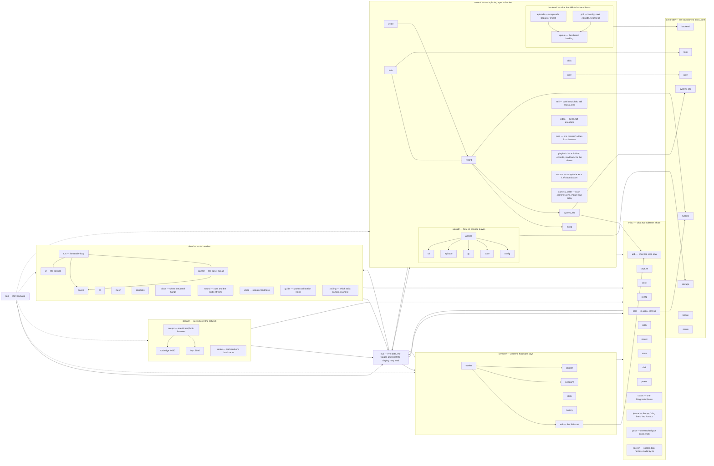

# Source layout

A map of `src/`. Build and deploy live in `docs/building.md`; this file is about
where code goes and why.

## Key principle

**Keep it short, small, and simple.** Use a library when it keeps the code
short; avoid it when it would bloat the software.

## Layout principles

1. **Imports go to siblings or ancestors only.** No module reaches into
   another subtree's children. A widely-shared module is therefore *forced*
   upward — which yields the second principle for free:
2. **The more important the code, the higher it lives.** `app.rs` (entry) and
   `hub/` (central state) sit at the top; ceremony like EGL setup
   (`view/gl.rs`) and usbfs ioctls (`sensors/webcam/usbfs.rs`) sinks to the
   bottom.

`tests/layout.rs` checks principle 1; principle 2 follows from it. A `mod.rs`
is usually a few lines of declarations and a doc comment that maps the
directory. Where the directory is one feature with helpers around it
(`hub/`, `misc/config/`, `record/mcap/`, `record/export/`,
`record/playback/`), its `mod.rs` holds that feature and the named files hold
the helpers.

## Dependency graph

Solid arrows point importer → imported, and every subgraph is a directory.
Dashed arrows are `app` starting a subtree's thread: it reaches into all of
them, and drawing that as imports would say nothing but "app is the entry".
`record/`, `sensors/` and `stream/` also reach the process's one `Hub`
through `app::hub()`. That call is drawn as their arrow into `hub`, because
the accessor is all they take from `app`.

`airoa-sdk/` is a sibling crate rather than a directory of `src/`, and it is
drawn here anyway: a map of this app that leaves out where the policy comes
from is a map of half of it. Each area of the boundary has one owner on this
side — `misc/core` for the runtime's lifecycle, `record/gate` for the verdict,
`record/task` for the FSM, `record/backend` for the backend, `record/upload`
for storage — and everything else takes what it needs from that owner rather
than from the SDK.

`view/` is the outermost layer: it reads `hub` every frame and runs its own
loop, and nothing inside depends on what is on screen. It has one arrow into
it. `hub::say_supply` calls `view::say_supply`, because the battery watcher
runs outside the render loop and still has to speak a change of supply. A
second arrow *into* `view/` would be the thing to worry about.

Between subtrees there are no arrows into another subtree's *children* any
more. Every subtree reads `hub` and `misc`, and `misc` reads a few names back
from `hub`: `SPACE_FLOOR` in `power`, `USB_CAM_SLOTS` in `usb` and `config`,
`Roles`, `Ports` and `episodes::clean_folder` in `config`, and `Hub` in
`speech`. `hub` reaches down into `record/`, `sensors/` and `view/`, which is
what an ancestor is for.
`tests/layout.rs` measures this and fails on the first import that reaches
across.

### Principle 1 holds, and a test keeps it so

No import crosses into another subtree's children. Two mistakes would make
one: filing a module under its first caller rather than its subject, and
having `view/` or `stream/` read `record/` directly to display an episode, which
they do through `hub` instead. `tests/layout.rs` fails on the first one.

`stream/` has no arrow into it at all: it reads and serves, and nothing
inside depends on what is on a socket.

## What the graph cannot show

**The interpreter never sees a frame.** The wasm boundary is entered at human
timescales — a gesture, a heartbeat, an 8 Hz gate tick — never from the capture
path, the USB reap thread, or a 10 Hz panel or rosbridge tick. Those read
caches.

**Never do work on the USB reap thread.** It is the thread that resubmits URBs.
Starving it raises no counter anywhere: the camera quietly fades its own frames
instead, and they arrive as complete, valid JPEGs carrying a washed-out
picture. Hand the bytes to a queue and get out.

**Boottime and wall clock are both real, and not interchangeable.** Sensors,
the gesture trace and the pre-roll live on boottime — the only clock that can
name an instant from before the episode opened. `signals.mcap` is stamped in
wall clock because rebake reads `log_time` as epoch nanoseconds, so every row
is converted on the way out and `meta.json` carries no clock of its own.

**Rust owns device policy and I/O; `airoa_core` owns task sequencing.** The app
maps gripper and controller input to core actions and supplies sensor
conditions. The core FSM advances subtasks and completes or cancels episodes,
and also supplies gate aggregation, backend operations, metadata validation and
storage policy. Nothing in `airoa-sdk` is a YUBI Go rule.

**Platform bindings are gated, protocol logic is not.** Only JNI, NDK, ioctl
and XR leaves carry `#[cfg(target_os = "android")]`. Everything else
host-compiles and is tested by plain `cargo test` — which is also why
`cargo test` passing says less than it looks like.

## Workspace

| crate | |
|---|---|
| `yubi-go` (root) | The Quest app, mapped above. |
| `airoa-sdk/` | Drawn above as its own subgraph, because thirteen files in `src/` call into it. Typed calls onto `airoa_core` over a WASIp2 Component, and nothing in it is a YUBI Go rule. State that has to outlive a call — the offline queue, the upload database — is upstream's own SQLite file under `files/db/`, reached through the mount; the lock directory its `unix-dotfile` VFS can strand on a force-stop is cleared by `misc::core` before the core starts. Any host can depend on it. |
| `reactive-svg/` | The panel's renderer: keyed SVG fragments drawn into one RGBA texture, redrawing only what changed. |
| `tts/` | Speech made on the headset with Kokoro-82M, for the task and subtask names `misc::speech` says. |
| `yubi-export/` | The `record::export` LeRobot export as a program for a computer, run over episodes copied off the headset. |
